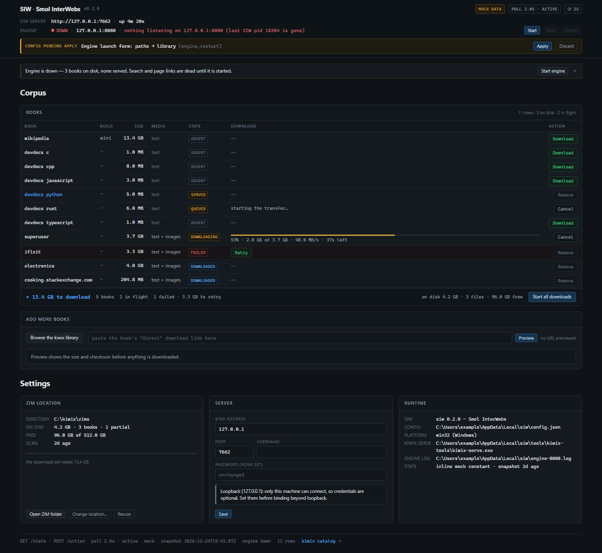

# S   ╱─╲   IW  •  Smol InterWebs

[](https://www.python.org/)
[](LICENSE)

[](https://kiwix.org)

SIW is an **offline fulltext search server** over the machine's own ZIM corpus — the [Kiwix](https://kiwix.org)
files: Wikipedia, the Stack Exchange network, API docs, whatever is on the disk — for you and/or your harness. 
Served as a documented HTTP API. `kiwix-serve` does the searching; SIW owns everything around it: the config, 
the engine's lifecycle, a download queue, the books' identity, and one loopback port that answers JSON, the
Model Context Protocol, and a web console that runs the whole machine.

> [!NOTE]
> SIW has been built by [S ╱─╲ H • Smol Agentic Harness](https://github.com/FrischCode/smol-agentic-harness) and comes with extensions for [SAH](https://github.com/FrischCode/smol-agentic-harness) as well as [Pi.dev](https://pi.dev/) while of course integrating well with any other agentic harness.

> [!NOTE]
> SIW ships the server, the console and the suggested set — not the books. The corpus is the operator's disk: the suggested set (~20 GB, one click in the console) or any ZIM pasted from the [Kiwix catalog](https://lb.download.kiwix.org) into the console's paste field. The one thing SIW fetches is the `kiwix-serve` binary itself — on first need, from a pinned URL, sha256- and 64-bit-checked before anything launches it.

## Screenshot

<details><summary>Click to enlarge screenshot</summary>
<a href="screenshot.png">
  
</a>
</details>
<a href="screenshot.png">
  
</a>

## Contents

- [Quickstart](#quickstart)
- [The front door (`siw.bat` / `siw.sh`)](#the-front-door-siwbat--siwsh)
- [The machine's own config](#the-machines-own-config)
- [The surface](#the-surface)
- [The console](#the-console)
- [How it works](#how-it-works)
- [Testing](#testing)
- [Credits](#credits)

## Quickstart

The tree is self-contained: a copy of it is the same product on another machine. It needs a corpus —
a folder of `.zim` files — and a Python `>= 3.11`; nothing is installed, because the core is
stdlib-only (the test suite wants `pytest` and nothing else):

```bat
rem 1. get the tree, somewhere stable:
git clone https://github.com/FrischCode/smol-interwebs C:\Work\SIW

rem 2. point it at the corpus and start the server; it opens the console it answers on
rem    (http://127.0.0.1:7662):
cd C:\Work\SIW
siw.bat --config siw.example.json
```

The first engine start fetches the pinned `kiwix-serve` (sha256-checked, 64-bit-verified) and leaves
it beside the config, where later starts pick it up. Then the console is the whole operation: start
the suggested downloads — or paste a book's "Direct" download link from the Kiwix catalog for the
last tier — Start engine, and search.

`python -m siw` is the whole server and every verb: `serve [--config PATH] [--port N] [--bind HOST]`,
`status`, `doctor [--query WORD]`, `stop`. The server listens on loopback only by default: a console
on a reachable interface would be a share of the machine, and binding beyond loopback is refused
unless a password is set.

## The front door (`siw.bat` / `siw.sh`)

- **`siw.bat` / `siw.sh`** — the front door: starts `python -m siw serve`; the console opens in a
  browser unless the config sets `open_browser` to `false` (the `.sh` is the POSIX door, same
  arguments). Extra arguments pass straight through (`siw.sh --port 8100`).
- **`siw-test.bat` / `siw-test.sh`** — the test suite, the same way a contributor runs it:
  `python -m pytest`.
- **`siw.example.json`** — the annotated config shape; the one file to copy when a machine states its
  own.

## The machine's own config

Resolution, first one found wins: `--config PATH` > `$SIW_CONFIG` > `./siw.json` (beside the tree)
> the machine's config dir > shipped defaults. A gitignored `siw.json` at the tree root is where this
machine states its own; `siw.example.json` is the committed shape. Environment variables fill only the
values no file names:

| key | the server reads it as |
|---|---|
| `SIW_CONFIG` | the config file's path |
| `SIW_CORPUS` | the folder holding the `.zim` files — the served set |
| `SIW_API_PORT` | the port the console and API answer on (shipped default: 7662) |
| `SIW_PORT` | the engine's port (shipped default: 18099) |
| `SIW_BIND` / `SIW_HOST` | the console's bind / the engine's bind (both loopback by default) |
| `SIW_USERNAME` / `SIW_PASSWORD` | the credential pair for a bind beyond loopback |
| `SIW_EXE` | a `kiwix-serve` the operator named; unset, SIW fetches the pinned one |
| `SIW_LAUNCH` | how the books reach the engine: `auto` (default) — every book on the command line while they fit, a generated library file once the corpus outgrows it; `paths` — command line only; `library` — the library file only, for a corpus too large for a command line |
| `SIW_OPEN_BROWSER` | whether a plain start opens the console in a browser (config key `open_browser`, default yes) — `false` in `siw.json` for no tab |

The field set is closed: an unknown key is a named refusal at load, never a silent drop.

## The surface

```
GET  /          the console page          POST /action    every verb, one JSON shape
GET  /state     one snapshot              GET  /search    fulltext over the pick; mode=grouped per book
GET  /catalog   name, size, picked        POST /mcp       MCP tools: search / list_books / add_book
GET  /spec      OpenAPI for this server   GET  /health    the engine probe
```

`mode=grouped` asks each book its own question and answers with each book's best hit and its own hit
count, so a small corpus is not drowned by a four-million-article Wikipedia; un-named, it answers
the topic map — which books hold the words at all. A zero-hit is a sentence on the wire (not in these
sources, or the corpus says none), never a silence: only a global zero-hit is a corpus-level
conclusion. The wire contract is [`web/CONTRACT.md`](web/CONTRACT.md); working reference adapters for
the harnesses that would call it stand in [`examples/`](examples/).

## The console

One page, no build step, no runtime dependency — it renders from `file://` against its own mock state
(`?mock=1`), which is how the screenshot above was taken and how the page is testable without a
corpus. What it does:

- **lists** — every book: the suggested set and everything already on disk, one row each, one state
  (`absent → queued → downloading → downloaded → served`) and exactly one action per row;
- **downloads** — the queue, with per-transfer progress, verification before a row ever leaves
  `downloading`, and the over-capacity refusal said in numbers;
- **runs the engine** — start / stop / restart against the engine's own truth (probe, then state),
  with a pending-apply banner for settings that land on the next restart;
- **states the machine** — the corpus's size and free space, the server's bind, the engine's log,
  and the settings that name all of it.

## How it works

- **The corpus directory is the served set.** A file in the folder is a book, whatever its name;
  `remove` is the only way a book leaves. SIW does not keep a second list that can drift.
- **Identity is a ladder, and it is self-contained.** The file's stem first (the high-confidence
  rung, it is the file's own name), the ZIM's embedded header second — no round-trip to any catalog,
  and a book nobody named still reads as its filename, low confidence, never hidden.
- **Verification before promotion.** A download is checked — sha256 where one was given, the ZIM
  header's integrity otherwise — before its row may leave `downloading`; the wire says which check
  passed.
- **The engine is SIW's act.** Probe before launch (a foreign engine on the port is never touched),
  launch detached with a pidfile record, and stop only what the record names — the stop checks the
  process's image against what the spawn recorded, because a recycled pid is not SIW's to kill.
- **Loopback is the boundary.** The default bind is `127.0.0.1`; a bind beyond loopback refuses
  without a password, and `POST /action` takes writes only from its own origin. The rest is in
  [`SECURITY.md`](SECURITY.md).
- **A refusal is a word.** Every act the server will not perform answers with the JSON error shape —
  a code a machine can branch on, a sentence a person can act on — never a silence the page has to
  guess at.
- **The ranking is the engine's.** SIW re-ranks nothing; it adds the per-book fairness route and the
  zero-hit semantics, and leaves the words to `kiwix-serve`.

## Testing

The suite stands under `tests/` and ships with the product: `siw-test.bat` / `siw-test.sh`
(or `python -m pytest`),
hermetic — no real engine, no network, no machine config. The engine is a seam (probe, catalog and
spawn are injectable), so a test that needed a real `kiwix-serve` or a real download could not ship
with the repo. One dev tool beyond the stdlib: `pip install pytest`. The suite stands on both
platforms — Windows and POSIX, the POSIX leg measured under WSL. Contributor rules and the invariants
are in [`AGENTS.md`](AGENTS.md).

## Credits

Built on [Kiwix](https://kiwix.org)'s `kiwix-serve`, and created, tested and inspired by using
[S ╱─╲ H](https://github.com/FrischCode/smol-agentic-harness), [Qwen 3.8 Flash Next](https://huggingface.co/Qwen/Qwen3.8-Flash-Next)
& [Qwen 3.8 27B](https://huggingface.co/Qwen/Qwen3.8-27B)

<sup>Nov - C. Frischmuth • 2026</sup>
